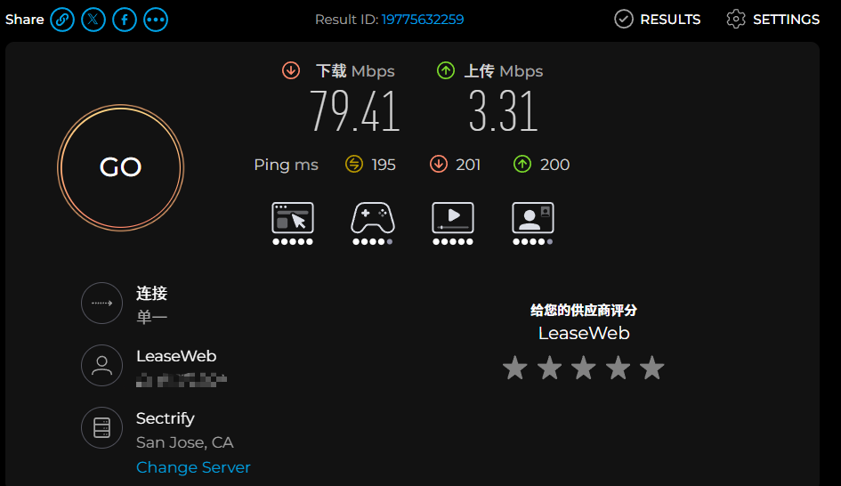
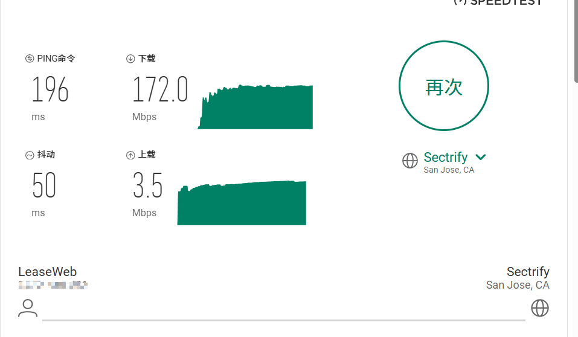
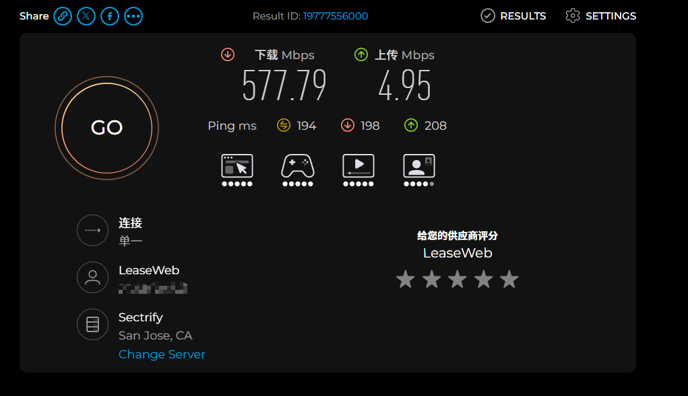
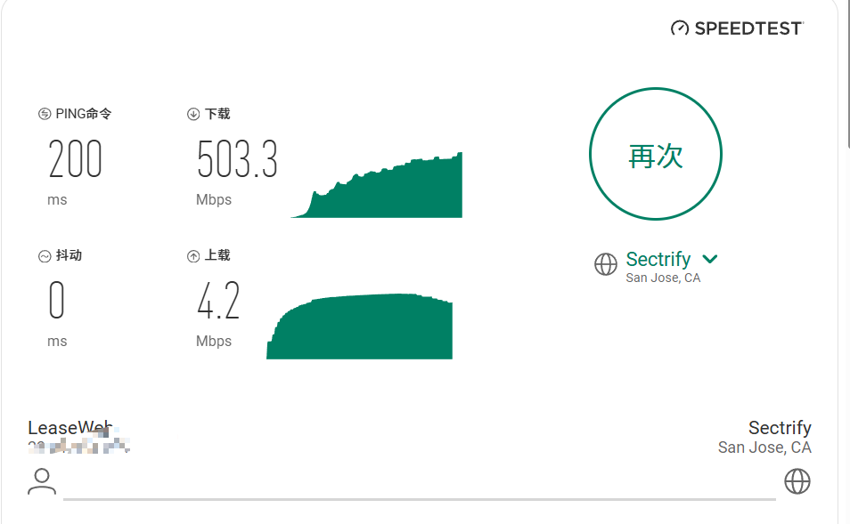

## 老规矩,先介绍一下这次使用的机器

| 商家            | 地区  | 核心  | 内存  | 硬盘   | 带宽  | 流量        | 价格  |
| ------------- | --- | --- | --- | ---- | --- | --------- | --- |
| **HostDZire** | SFO | 4C  | 6G  | 100G | 10G | 25T(只计上传) | $22 |


---

## 这是VPS去回程路由(本地贵州移动1000M宽带)

### 回程:

```
3   173.208.122.x   AS7203                    美国 加利福尼亚 洛杉矶  leaseweb.com 
    be-3.br02.sfo-12.us.leaseweb.net          1.02 ms / 0.95 ms / 0.89 ms
4   69.174.12.37    AS3257                    美国 加利福尼亚 圣何塞  gtt.net 
    ae14-197.cr1-sjc2.ip4.gtt.net             0.91 ms / 0.71 ms / 0.59 ms
5   89.149.128.174  *        [GTT-BACKBONE]   美国 加利福尼亚 洛杉矶        
                                              9.63 ms / 10.16 ms / 9.59 ms
6   198.47.106.150  AS3257                    美国 弗吉尼亚州 麦克莱恩  gtt.net 
                                              11.12 ms / 11.12 ms / 11.43 ms
7   223.120.6.217   AS58453  [CMI-INT]        美国 加利福尼亚 洛杉矶  cmi.chinamobile.com  移动
                                              11.27 ms / 11.45 ms / 11.31 ms
8   223.120.14.238  AS58453  [CMI-INT]        中国 广东 广州  cmi.chinamobile.com 
                                              161.32 ms / 161.40 ms / 161.41 ms
9   221.183.92.197  AS9808   [CMNET]          中国 广东 广州  chinamobileltd.com  移动
                                              159.37 ms / 159.28 ms / 159.20 ms
```

### 去程:

```
11  221.183.92.194  AS9808   [CMNET]          中国 广东 广州  chinamobileltd.com  移动
                                              36.79 ms / 36.68 ms / 36.57 ms
12  223.120.16.241  AS58453  [CMI-INT]        中国 香港   cmi.chinamobile.com 
                                              189.56 ms / 189.57 ms / 189.54 ms
13  223.118.10.250  AS58453  [CMI-INT]        美国 加利福尼亚 洛杉矶  cmi.chinamobile.com 
                                              190.58 ms / 190.45 ms / 190.62 ms
14  *
15  154.54.3.69     AS174    [COGENT-BONE]    美国 加利福尼亚 洛杉矶  cogentco.com 
                                              192.76 ms / 192.40 ms / 192.65 ms
16  154.54.169.1    AS174    [COGENT-BONE]    美国 加利福尼亚 圣何塞  cogentco.com 
                                              203.78 ms / 202.85 ms / * ms
17  154.54.168.190  AS174    [COGENT-BONE]    美国 加利福尼亚 圣何塞  cogentco.com 
                                              202.68 ms / 202.50 ms / * ms
18  154.24.12.181   AS174    [COGENT-BONE]    美国 加利福尼亚 圣何塞  cogentco.com 
                                              199.25 ms / 198.64 ms / 199.36 ms
19  38.122.94.66    AS174                     美国 加利福尼亚 圣何塞  cogentco.com 
                                              200.63 ms / 200.73 ms / * ms
20  173.208.122.x   AS7203                    美国 加利福尼亚 洛杉矶  leaseweb.com 
                                              195.66 ms / 195.81 ms / 195.43 ms
```

---

## 先来看下下午2点10分左右的表现

### 持续ping 3分钟左右,丢包12%左右

```
--- 23.81.118.x ping statistics ---
203 packets transmitted, 179 received, 11.8227% packet loss, time 202667ms
rtt min/avg/max/mdev = 196.526/197.667/199.318/0.316 ms
```

---

### 这是网络质量测试图


---

### 使用iperf3持续3分钟打流下载

```
root@debian:~# iperf3 -c 23.81.118.x -R -t 180
Connecting to host 23.81.118.x, port 5201
[  5] local 192.168.1.98 port 11048 connected to 23.81.118.x port 5201
[ ID] Interval           Transfer     Bitrate
[  5]   0.00-1.00   sec   153 KBytes  1.26 Mbits/sec                  
[  5]   1.00-2.00   sec   595 KBytes  4.88 Mbits/sec                  
[  5]   2.00-3.00   sec  2.72 MBytes  22.8 Mbits/sec                  
[  5]   3.00-4.00   sec  7.05 MBytes  59.2 Mbits/sec                  
[  5]   4.00-5.00   sec  11.8 MBytes  98.7 Mbits/sec                  
[  5]   5.00-6.00   sec  13.0 MBytes   109 Mbits/sec                  
[  5]   6.00-7.00   sec  10.4 MBytes  87.4 Mbits/sec                  
[  5]   7.00-8.00   sec  13.5 MBytes   113 Mbits/sec                  
[  5]   8.00-9.00   sec  13.6 MBytes   114 Mbits/sec                  
[  5]   9.00-10.00  sec  9.47 MBytes  79.5 Mbits/sec                  
[  5]  10.00-11.00  sec  13.5 MBytes   114 Mbits/sec                  
[  5]  11.00-12.00  sec  14.2 MBytes   119 Mbits/sec                  
[  5]  12.00-13.00  sec  12.4 MBytes   104 Mbits/sec                  
[  5]  13.00-14.00  sec  12.6 MBytes   106 Mbits/sec                  
[  5]  14.00-15.00  sec  16.6 MBytes   139 Mbits/sec                  
[  5]  15.00-16.00  sec  8.40 MBytes  70.5 Mbits/sec                  
[  5]  16.00-17.00  sec  12.3 MBytes   103 Mbits/sec                  
[  5]  17.00-18.00  sec  17.4 MBytes   146 Mbits/sec                  
[  5]  18.00-19.00  sec  12.6 MBytes   106 Mbits/sec                  
[  5]  19.00-20.00  sec  10.4 MBytes  87.2 Mbits/sec                  
[  5]  20.00-21.00  sec  12.9 MBytes   108 Mbits/sec                  
[  5]  21.00-22.00  sec  16.8 MBytes   141 Mbits/sec                  
[  5]  22.00-23.00  sec  12.2 MBytes   102 Mbits/sec                  
[  5]  23.00-24.00  sec  6.63 MBytes  55.6 Mbits/sec                  
[  5]  24.00-25.00  sec  12.1 MBytes   101 Mbits/sec                  
[  5]  25.00-26.00  sec  16.2 MBytes   136 Mbits/sec                  
[  5]  26.00-27.00  sec  9.30 MBytes  78.0 Mbits/sec                  
[  5]  27.00-28.00  sec  13.5 MBytes   113 Mbits/sec                  
[  5]  28.00-29.00  sec  11.6 MBytes  97.1 Mbits/sec                  
[  5]  29.00-30.00  sec  12.2 MBytes   103 Mbits/sec                  
[  5]  30.00-31.00  sec  14.6 MBytes   123 Mbits/sec                  
[  5]  31.00-32.00  sec  17.0 MBytes   143 Mbits/sec                  
[  5]  32.00-33.00  sec  14.0 MBytes   117 Mbits/sec                  
[  5]  33.00-34.00  sec  14.6 MBytes   122 Mbits/sec                  
[  5]  34.00-35.00  sec  13.0 MBytes   109 Mbits/sec                  
[  5]  35.00-36.00  sec  12.0 MBytes   100 Mbits/sec                  
[  5]  36.00-37.00  sec  18.1 MBytes   152 Mbits/sec                  
[  5]  37.00-38.00  sec  12.4 MBytes   104 Mbits/sec                  
[  5]  38.00-39.00  sec  15.7 MBytes   131 Mbits/sec                  
[  5]  39.00-40.00  sec  16.3 MBytes   137 Mbits/sec                  
[  5]  40.00-41.00  sec  14.4 MBytes   121 Mbits/sec                  
[  5]  41.00-42.00  sec  16.0 MBytes   134 Mbits/sec                  
[  5]  42.00-43.00  sec  16.0 MBytes   134 Mbits/sec                  
[  5]  43.00-44.00  sec  8.28 MBytes  69.5 Mbits/sec                  
[  5]  44.00-45.00  sec  12.0 MBytes   101 Mbits/sec                  
[  5]  45.00-46.00  sec  13.2 MBytes   111 Mbits/sec                  
[  5]  46.00-47.00  sec  15.7 MBytes   132 Mbits/sec                  
[  5]  47.00-48.00  sec  17.1 MBytes   144 Mbits/sec                  
[  5]  48.00-49.00  sec  11.4 MBytes  96.0 Mbits/sec                  
[  5]  49.00-50.00  sec  13.1 MBytes   110 Mbits/sec                  
[  5]  50.00-51.00  sec  15.3 MBytes   128 Mbits/sec                  
[  5]  51.00-52.00  sec  11.1 MBytes  92.8 Mbits/sec                  
[  5]  52.00-53.00  sec  17.8 MBytes   149 Mbits/sec                  
[  5]  53.00-54.00  sec  13.4 MBytes   112 Mbits/sec                  
[  5]  54.00-55.00  sec  16.4 MBytes   138 Mbits/sec                  
[  5]  55.00-56.00  sec  15.0 MBytes   126 Mbits/sec                  
[  5]  56.00-57.00  sec  13.9 MBytes   117 Mbits/sec                  
[  5]  57.00-58.00  sec  13.4 MBytes   112 Mbits/sec                  
[  5]  58.00-59.00  sec  16.0 MBytes   134 Mbits/sec                  
[  5]  59.00-60.00  sec  16.1 MBytes   135 Mbits/sec                  
[  5]  60.00-61.00  sec  11.6 MBytes  97.2 Mbits/sec                  
[  5]  61.00-62.00  sec  9.41 MBytes  78.9 Mbits/sec                  
[  5]  62.00-63.00  sec  11.6 MBytes  97.1 Mbits/sec                  
[  5]  63.00-64.00  sec  15.2 MBytes   128 Mbits/sec                  
[  5]  64.00-65.00  sec  15.7 MBytes   132 Mbits/sec                  
[  5]  65.00-66.00  sec  13.2 MBytes   111 Mbits/sec                  
[  5]  66.00-67.00  sec  13.2 MBytes   110 Mbits/sec                  
[  5]  67.00-68.00  sec  14.6 MBytes   122 Mbits/sec                  
[  5]  68.00-69.00  sec  15.2 MBytes   128 Mbits/sec                  
[  5]  69.00-70.00  sec  12.6 MBytes   105 Mbits/sec                  
[  5]  70.00-71.00  sec  13.7 MBytes   115 Mbits/sec                  
[  5]  71.00-72.00  sec  13.3 MBytes   112 Mbits/sec                  
[  5]  72.00-73.00  sec  8.82 MBytes  74.0 Mbits/sec                  
[  5]  73.00-74.00  sec  11.4 MBytes  95.9 Mbits/sec                  
[  5]  74.00-75.00  sec  14.7 MBytes   123 Mbits/sec                  
[  5]  75.00-76.00  sec  13.7 MBytes   115 Mbits/sec                  
[  5]  76.00-77.00  sec  16.1 MBytes   135 Mbits/sec                  
[  5]  77.00-78.00  sec  15.3 MBytes   128 Mbits/sec                  
[  5]  78.00-79.00  sec  15.8 MBytes   133 Mbits/sec                  
[  5]  79.00-80.00  sec  16.0 MBytes   134 Mbits/sec                  
[  5]  80.00-81.00  sec  17.5 MBytes   147 Mbits/sec                  
[  5]  81.00-82.00  sec  6.10 MBytes  51.2 Mbits/sec                  
[  5]  82.00-83.00  sec  12.7 MBytes   107 Mbits/sec                  
[  5]  83.00-84.00  sec  13.7 MBytes   115 Mbits/sec                  
[  5]  84.00-85.00  sec  17.3 MBytes   145 Mbits/sec                  
[  5]  85.00-86.00  sec  12.1 MBytes   101 Mbits/sec                  
[  5]  86.00-87.00  sec  20.0 MBytes   168 Mbits/sec                  
[  5]  87.00-88.00  sec  13.7 MBytes   114 Mbits/sec                  
[  5]  88.00-89.00  sec  2.53 MBytes  21.2 Mbits/sec                  
[  5]  89.00-90.00  sec  14.0 MBytes   117 Mbits/sec                  
[  5]  90.00-91.00  sec  18.2 MBytes   153 Mbits/sec                  
[  5]  91.00-92.00  sec  12.4 MBytes   104 Mbits/sec                  
[  5]  92.00-93.00  sec  15.8 MBytes   133 Mbits/sec                  
[  5]  93.00-94.00  sec  16.2 MBytes   136 Mbits/sec                  
[  5]  94.00-95.00  sec  9.68 MBytes  81.2 Mbits/sec                  
[  5]  95.00-96.00  sec  19.3 MBytes   162 Mbits/sec                  
[  5]  96.00-97.00  sec  10.4 MBytes  87.6 Mbits/sec                  
[  5]  97.00-98.00  sec  10.3 MBytes  86.4 Mbits/sec                  
[  5]  98.00-99.00  sec  15.9 MBytes   134 Mbits/sec                  
[  5]  99.00-100.00 sec  10.9 MBytes  91.5 Mbits/sec                  
[  5] 100.00-101.00 sec  12.1 MBytes   101 Mbits/sec                  
[  5] 101.00-102.00 sec  21.4 MBytes   180 Mbits/sec                  
[  5] 102.00-103.00 sec  18.3 MBytes   153 Mbits/sec                  
[  5] 103.00-104.00 sec  5.06 MBytes  42.4 Mbits/sec                  
[  5] 104.00-105.00 sec  12.7 MBytes   107 Mbits/sec                  
[  5] 105.00-106.00 sec  14.4 MBytes   120 Mbits/sec                  
[  5] 106.00-107.00 sec  8.26 MBytes  69.4 Mbits/sec                  
[  5] 107.00-108.00 sec  11.0 MBytes  92.5 Mbits/sec                  
[  5] 108.00-109.00 sec  14.5 MBytes   122 Mbits/sec                  
[  5] 109.00-110.00 sec  14.4 MBytes   121 Mbits/sec                  
[  5] 110.00-111.00 sec  13.6 MBytes   114 Mbits/sec                  
[  5] 111.00-112.00 sec  15.1 MBytes   126 Mbits/sec                  
[  5] 112.00-113.00 sec  14.2 MBytes   119 Mbits/sec                  
[  5] 113.00-114.00 sec  16.0 MBytes   134 Mbits/sec                  
[  5] 114.00-115.00 sec  16.0 MBytes   134 Mbits/sec                  
[  5] 115.00-116.00 sec  4.74 MBytes  39.7 Mbits/sec                  
[  5] 116.00-117.00 sec  13.1 MBytes   110 Mbits/sec                  
[  5] 117.00-118.00 sec  16.8 MBytes   141 Mbits/sec                  
[  5] 118.00-119.00 sec  12.0 MBytes   101 Mbits/sec                  
[  5] 119.00-120.00 sec  15.5 MBytes   130 Mbits/sec                  
[  5] 120.00-121.00 sec  15.0 MBytes   126 Mbits/sec                  
[  5] 121.00-122.00 sec  7.16 MBytes  60.1 Mbits/sec                  
[  5] 122.00-123.00 sec  12.0 MBytes   100 Mbits/sec                  
[  5] 123.00-124.00 sec  15.1 MBytes   127 Mbits/sec                  
[  5] 124.00-125.00 sec  14.5 MBytes   122 Mbits/sec                  
[  5] 125.00-126.00 sec  1.77 MBytes  14.9 Mbits/sec                  
[  5] 126.00-127.00 sec  13.1 MBytes   110 Mbits/sec                  
[  5] 127.00-128.00 sec  22.3 MBytes   187 Mbits/sec                  
[  5] 128.00-129.00 sec  16.9 MBytes   142 Mbits/sec                  
[  5] 129.00-130.00 sec  6.52 MBytes  54.7 Mbits/sec                  
[  5] 130.00-131.00 sec  9.75 MBytes  81.8 Mbits/sec                  
[  5] 131.00-132.00 sec  13.7 MBytes   115 Mbits/sec                  
[  5] 132.00-133.00 sec  15.5 MBytes   130 Mbits/sec                  
[  5] 133.00-134.00 sec  14.2 MBytes   119 Mbits/sec                  
[  5] 134.00-135.00 sec  14.0 MBytes   117 Mbits/sec                  
[  5] 135.00-136.00 sec  14.5 MBytes   122 Mbits/sec                  
[  5] 136.00-137.00 sec  3.23 MBytes  27.1 Mbits/sec                  
[  5] 137.00-138.00 sec  15.0 MBytes   126 Mbits/sec                  
[  5] 138.00-139.00 sec  14.1 MBytes   118 Mbits/sec                  
[  5] 139.00-140.00 sec  13.5 MBytes   114 Mbits/sec                  
[  5] 140.00-141.00 sec  12.7 MBytes   107 Mbits/sec                  
[  5] 141.00-142.00 sec  11.8 MBytes  99.1 Mbits/sec                  
[  5] 142.00-143.00 sec  13.9 MBytes   116 Mbits/sec                  
[  5] 143.00-144.00 sec  14.7 MBytes   123 Mbits/sec                  
[  5] 144.00-145.00 sec  13.5 MBytes   113 Mbits/sec                  
[  5] 145.00-146.00 sec  14.1 MBytes   118 Mbits/sec                  
[  5] 146.00-147.00 sec  11.0 MBytes  92.3 Mbits/sec                  
[  5] 147.00-148.00 sec  13.2 MBytes   111 Mbits/sec                  
[  5] 148.00-149.00 sec  12.1 MBytes   101 Mbits/sec                  
[  5] 149.00-150.00 sec  13.2 MBytes   110 Mbits/sec                  
[  5] 150.00-151.00 sec  9.93 MBytes  83.3 Mbits/sec                  
[  5] 151.00-152.00 sec  13.4 MBytes   112 Mbits/sec                  
[  5] 152.00-153.00 sec  9.01 MBytes  75.5 Mbits/sec                  
[  5] 153.00-154.00 sec  4.89 MBytes  41.0 Mbits/sec                  
[  5] 154.00-155.00 sec  19.9 MBytes   167 Mbits/sec                  
[  5] 155.00-156.00 sec  14.0 MBytes   117 Mbits/sec                  
[  5] 156.00-157.00 sec  10.9 MBytes  91.3 Mbits/sec                  
[  5] 157.00-158.00 sec  16.0 MBytes   134 Mbits/sec                  
[  5] 158.00-159.00 sec  11.7 MBytes  98.4 Mbits/sec                  
[  5] 159.00-160.00 sec  12.1 MBytes   101 Mbits/sec                  
[  5] 160.00-161.00 sec  15.3 MBytes   128 Mbits/sec                  
[  5] 161.00-162.00 sec  14.7 MBytes   123 Mbits/sec                  
[  5] 162.00-163.00 sec  13.9 MBytes   116 Mbits/sec                  
[  5] 163.00-164.00 sec  16.3 MBytes   137 Mbits/sec                  
[  5] 164.00-165.00 sec  8.99 MBytes  75.4 Mbits/sec                  
[  5] 165.00-166.00 sec  17.9 MBytes   150 Mbits/sec                  
[  5] 166.00-167.00 sec  14.8 MBytes   124 Mbits/sec                  
[  5] 167.00-168.00 sec  12.9 MBytes   108 Mbits/sec                  
[  5] 168.00-169.00 sec  20.7 MBytes   174 Mbits/sec                  
[  5] 169.00-170.00 sec  15.4 MBytes   129 Mbits/sec                  
[  5] 170.00-171.00 sec  14.2 MBytes   120 Mbits/sec                  
[  5] 171.00-172.00 sec  4.53 MBytes  38.0 Mbits/sec                  
[  5] 172.00-173.00 sec  20.0 MBytes   168 Mbits/sec                  
[  5] 173.00-174.00 sec  9.39 MBytes  78.8 Mbits/sec                  
[  5] 174.00-175.00 sec  6.69 MBytes  56.1 Mbits/sec                  
[  5] 175.00-176.00 sec  15.4 MBytes   129 Mbits/sec                  
[  5] 176.00-177.00 sec  15.5 MBytes   130 Mbits/sec                  
[  5] 177.00-178.00 sec  12.9 MBytes   108 Mbits/sec                  
[  5] 178.00-179.00 sec  13.7 MBytes   115 Mbits/sec                  
[  5] 179.00-180.00 sec  13.6 MBytes   114 Mbits/sec                  
- - - - - - - - - - - - - - - - - - - - - - - - -
[ ID] Interval           Transfer     Bitrate         Retr
[  5]   0.00-180.20 sec  2.32 GBytes   110 Mbits/sec  162474             sender
[  5]   0.00-180.00 sec  2.30 GBytes   110 Mbits/sec                  receiver
```

---

### 使用Speedtest进行单线程测速



---

### 使用Google Fiber进行多线程测速



---

## 再来看看凌晨4点20左右的表现

### **持续ping 3分钟左右,无丢包**

```
--- 23.81.118.x ping statistics ---
180 packets transmitted, 180 received, 0% packet loss, time 179283ms
rtt min/avg/max/mdev = 196.151/196.689/200.193/0.381 ms
```

---

### **这是网络质量测试图**


---

### 使用iperf3持续3分钟打流下载

```
root@debian:~# iperf3 -c 23.81.118.x -R -t 300 
Connecting to host 23.81.118.x, port 5201
[  5] local 192.168.1.98 port 33688 connected to 23.81.118.x port 5201
[ ID] Interval           Transfer     Bitrate
[  5]   0.00-1.00   sec   858 KBytes  7.02 Mbits/sec                  
[  5]   1.00-2.00   sec  30.7 MBytes   258 Mbits/sec                  
[  5]   2.00-3.00   sec  82.4 MBytes   691 Mbits/sec                  
[  5]   3.00-4.00   sec  83.2 MBytes   698 Mbits/sec                  
[  5]   4.00-5.00   sec  63.7 MBytes   534 Mbits/sec                  
[  5]   5.00-6.00   sec  77.9 MBytes   654 Mbits/sec                  
[  5]   6.00-7.00   sec  83.7 MBytes   702 Mbits/sec                  
[  5]   7.00-8.00   sec  83.6 MBytes   701 Mbits/sec                  
[  5]   8.00-9.00   sec  83.6 MBytes   701 Mbits/sec                  
[  5]   9.00-10.00  sec  83.6 MBytes   701 Mbits/sec                  
[  5]  10.00-11.00  sec  57.9 MBytes   486 Mbits/sec                  
[  5]  11.00-12.00  sec  83.4 MBytes   700 Mbits/sec                  
[  5]  12.00-13.00  sec  35.8 MBytes   300 Mbits/sec                  
[  5]  13.00-14.00  sec  60.2 MBytes   505 Mbits/sec                  
[  5]  14.00-15.00  sec  83.9 MBytes   704 Mbits/sec                  
[  5]  15.00-16.00  sec  55.8 MBytes   468 Mbits/sec                  
[  5]  16.00-17.00  sec  83.3 MBytes   699 Mbits/sec                  
[  5]  17.00-18.00  sec  74.7 MBytes   627 Mbits/sec                  
[  5]  18.00-19.00  sec  66.6 MBytes   559 Mbits/sec                  
[  5]  19.00-20.00  sec  83.6 MBytes   701 Mbits/sec                  
[  5]  20.00-21.00  sec  83.6 MBytes   701 Mbits/sec                  
[  5]  21.00-22.00  sec  83.1 MBytes   697 Mbits/sec                  
[  5]  22.00-23.00  sec  58.0 MBytes   487 Mbits/sec                  
[  5]  23.00-24.00  sec  63.5 MBytes   533 Mbits/sec                  
[  5]  24.00-25.00  sec  77.9 MBytes   653 Mbits/sec                  
[  5]  25.00-26.00  sec  83.5 MBytes   701 Mbits/sec                  
[  5]  26.00-27.00  sec  71.9 MBytes   603 Mbits/sec                  
[  5]  27.00-28.00  sec  47.2 MBytes   396 Mbits/sec                  
[  5]  28.00-29.00  sec  80.1 MBytes   672 Mbits/sec                  
[  5]  29.00-30.00  sec  61.4 MBytes   515 Mbits/sec                  
[  5]  30.00-31.00  sec  58.2 MBytes   488 Mbits/sec                  
[  5]  31.00-32.00  sec  74.4 MBytes   624 Mbits/sec                  
[  5]  32.00-33.00  sec  70.6 MBytes   593 Mbits/sec                  
[  5]  33.00-34.00  sec  84.0 MBytes   705 Mbits/sec                  
[  5]  34.00-35.00  sec  80.8 MBytes   678 Mbits/sec                  
[  5]  35.00-36.00  sec  84.0 MBytes   704 Mbits/sec                  
[  5]  36.00-37.00  sec  84.3 MBytes   707 Mbits/sec                  
[  5]  37.00-38.00  sec  67.7 MBytes   567 Mbits/sec                  
[  5]  38.00-39.00  sec  74.0 MBytes   621 Mbits/sec                  
[  5]  39.00-40.00  sec  62.8 MBytes   526 Mbits/sec                  
[  5]  40.00-41.00  sec  48.8 MBytes   409 Mbits/sec                  
[  5]  41.00-42.00  sec  75.8 MBytes   635 Mbits/sec                  
[  5]  42.00-43.00  sec  65.9 MBytes   553 Mbits/sec                  
[  5]  43.00-44.00  sec  58.2 MBytes   488 Mbits/sec                  
[  5]  44.00-45.00  sec  82.8 MBytes   695 Mbits/sec                  
[  5]  45.00-46.00  sec  57.2 MBytes   480 Mbits/sec                  
[  5]  46.00-47.00  sec  83.3 MBytes   699 Mbits/sec                  
[  5]  47.00-48.00  sec  83.7 MBytes   702 Mbits/sec                  
[  5]  48.00-49.00  sec  83.1 MBytes   697 Mbits/sec                  
[  5]  49.00-50.00  sec  57.9 MBytes   485 Mbits/sec                  
[  5]  50.00-51.00  sec  83.4 MBytes   699 Mbits/sec                  
[  5]  51.00-52.00  sec  83.4 MBytes   700 Mbits/sec                  
[  5]  52.00-53.00  sec  83.4 MBytes   699 Mbits/sec                  
[  5]  53.00-54.00  sec  83.7 MBytes   702 Mbits/sec                  
[  5]  54.00-55.00  sec  57.8 MBytes   485 Mbits/sec                  
[  5]  55.00-56.00  sec  83.5 MBytes   700 Mbits/sec                  
[  5]  56.00-57.00  sec  83.6 MBytes   701 Mbits/sec                  
[  5]  57.00-58.00  sec  83.3 MBytes   699 Mbits/sec                  
[  5]  58.00-59.00  sec  45.0 MBytes   377 Mbits/sec                  
[  5]  59.00-60.00  sec  49.0 MBytes   411 Mbits/sec                  
[  5]  60.00-61.00  sec  83.7 MBytes   702 Mbits/sec                  
[  5]  61.00-62.00  sec  57.9 MBytes   486 Mbits/sec                  
[  5]  62.00-63.00  sec  59.5 MBytes   499 Mbits/sec                  
[  5]  63.00-64.00  sec  84.3 MBytes   707 Mbits/sec                  
[  5]  64.00-65.00  sec  62.9 MBytes   528 Mbits/sec                  
[  5]  65.00-66.00  sec  70.2 MBytes   589 Mbits/sec                  
[  5]  66.00-67.00  sec  67.2 MBytes   564 Mbits/sec                  
[  5]  67.00-68.00  sec  55.8 MBytes   468 Mbits/sec                  
[  5]  68.00-69.00  sec  58.1 MBytes   487 Mbits/sec                  
[  5]  69.00-70.00  sec  84.5 MBytes   709 Mbits/sec                  
[  5]  70.00-71.00  sec  81.4 MBytes   683 Mbits/sec                  
[  5]  71.00-72.00  sec  38.2 MBytes   321 Mbits/sec                  
[  5]  72.00-73.00  sec  83.6 MBytes   701 Mbits/sec                  
[  5]  73.00-74.00  sec  83.5 MBytes   700 Mbits/sec                  
[  5]  74.00-75.00  sec  63.5 MBytes   532 Mbits/sec                  
[  5]  75.00-76.00  sec  77.6 MBytes   651 Mbits/sec                  
[  5]  76.00-77.00  sec  83.7 MBytes   702 Mbits/sec                  
[  5]  77.00-78.00  sec  83.2 MBytes   698 Mbits/sec                  
[  5]  78.00-79.00  sec  83.8 MBytes   703 Mbits/sec                  
[  5]  79.00-80.00  sec  83.7 MBytes   702 Mbits/sec                  
[  5]  80.00-81.00  sec  62.5 MBytes   524 Mbits/sec                  
[  5]  81.00-82.00  sec  79.2 MBytes   664 Mbits/sec                  
[  5]  82.00-83.00  sec  83.7 MBytes   702 Mbits/sec                  
[  5]  83.00-84.00  sec  63.7 MBytes   534 Mbits/sec                  
[  5]  84.00-85.00  sec  77.9 MBytes   653 Mbits/sec                  
[  5]  85.00-86.00  sec  83.7 MBytes   702 Mbits/sec                  
[  5]  86.00-87.00  sec  83.7 MBytes   702 Mbits/sec                  
[  5]  87.00-88.00  sec  83.7 MBytes   702 Mbits/sec                  
[  5]  88.00-89.00  sec  73.8 MBytes   619 Mbits/sec                  
[  5]  89.00-90.00  sec  17.8 MBytes   149 Mbits/sec                  
[  5]  90.00-91.00  sec  83.7 MBytes   702 Mbits/sec                  
[  5]  91.00-92.00  sec  83.5 MBytes   701 Mbits/sec                  
[  5]  92.00-93.00  sec  58.0 MBytes   486 Mbits/sec                  
[  5]  93.00-94.00  sec  83.6 MBytes   701 Mbits/sec                  
[  5]  94.00-95.00  sec  83.5 MBytes   701 Mbits/sec                  
[  5]  95.00-96.00  sec  58.0 MBytes   487 Mbits/sec                  
[  5]  96.00-97.00  sec  83.5 MBytes   701 Mbits/sec                  
[  5]  97.00-98.00  sec  83.7 MBytes   702 Mbits/sec                  
[  5]  98.00-99.00  sec  68.4 MBytes   573 Mbits/sec                  
[  5]  99.00-100.00 sec  53.2 MBytes   446 Mbits/sec                  
[  5] 100.00-101.00 sec  78.0 MBytes   655 Mbits/sec                  
[  5] 101.00-102.00 sec  83.5 MBytes   701 Mbits/sec                  
[  5] 102.00-103.00 sec  83.5 MBytes   701 Mbits/sec                  
[  5] 103.00-104.00 sec  83.6 MBytes   701 Mbits/sec                  
[  5] 104.00-105.00 sec  55.6 MBytes   466 Mbits/sec                  
[  5] 105.00-106.00 sec  71.3 MBytes   598 Mbits/sec                  
[  5] 106.00-107.00 sec  83.6 MBytes   702 Mbits/sec                  
[  5] 107.00-108.00 sec  83.5 MBytes   700 Mbits/sec                  
[  5] 108.00-109.00 sec  83.3 MBytes   699 Mbits/sec                  
[  5] 109.00-110.00 sec  82.4 MBytes   691 Mbits/sec                  
[  5] 110.00-111.00 sec  83.4 MBytes   699 Mbits/sec                  
[  5] 111.00-112.00 sec  83.8 MBytes   703 Mbits/sec                  
[  5] 112.00-113.00 sec  51.4 MBytes   431 Mbits/sec                  
[  5] 113.00-114.00 sec  42.5 MBytes   356 Mbits/sec                  
[  5] 114.00-115.00 sec  83.2 MBytes   698 Mbits/sec                  
[  5] 115.00-116.00 sec  62.6 MBytes   525 Mbits/sec                  
[  5] 116.00-117.00 sec  78.9 MBytes   662 Mbits/sec                  
[  5] 117.00-118.00 sec  83.7 MBytes   702 Mbits/sec                  
[  5] 118.00-119.00 sec  83.3 MBytes   699 Mbits/sec                  
[  5] 119.00-120.00 sec  83.3 MBytes   699 Mbits/sec                  
[  5] 120.00-121.00 sec  83.9 MBytes   704 Mbits/sec                  
[  5] 121.00-122.00 sec  83.5 MBytes   700 Mbits/sec                  
[  5] 122.00-123.00 sec  57.9 MBytes   486 Mbits/sec                  
[  5] 123.00-124.00 sec  74.5 MBytes   625 Mbits/sec                  
[  5] 124.00-125.00 sec  53.3 MBytes   447 Mbits/sec                  
[  5] 125.00-126.00 sec  64.3 MBytes   540 Mbits/sec                  
[  5] 126.00-127.00 sec  66.3 MBytes   557 Mbits/sec                  
[  5] 127.00-128.00 sec  83.5 MBytes   700 Mbits/sec                  
[  5] 128.00-129.00 sec  83.5 MBytes   701 Mbits/sec                  
[  5] 129.00-130.00 sec  83.4 MBytes   700 Mbits/sec                  
[  5] 130.00-131.00 sec  83.7 MBytes   703 Mbits/sec                  
[  5] 131.00-132.00 sec  83.1 MBytes   697 Mbits/sec                  
[  5] 132.00-133.00 sec  83.8 MBytes   703 Mbits/sec                  
[  5] 133.00-134.00 sec  58.1 MBytes   488 Mbits/sec                  
[  5] 134.00-135.00 sec  74.7 MBytes   626 Mbits/sec                  
[  5] 135.00-136.00 sec  42.7 MBytes   359 Mbits/sec                  
[  5] 136.00-137.00 sec  60.6 MBytes   509 Mbits/sec                  
[  5] 137.00-138.00 sec  83.0 MBytes   696 Mbits/sec                  
[  5] 138.00-139.00 sec  81.8 MBytes   687 Mbits/sec                  
[  5] 139.00-140.00 sec  37.3 MBytes   313 Mbits/sec                  
[  5] 140.00-141.00 sec  83.5 MBytes   700 Mbits/sec                  
[  5] 141.00-142.00 sec  83.6 MBytes   701 Mbits/sec                  
[  5] 142.00-143.00 sec  83.6 MBytes   701 Mbits/sec                  
[  5] 143.00-144.00 sec  74.6 MBytes   625 Mbits/sec                  
[  5] 144.00-145.00 sec  66.4 MBytes   557 Mbits/sec                  
[  5] 145.00-146.00 sec  83.6 MBytes   702 Mbits/sec                  
[  5] 146.00-147.00 sec  75.6 MBytes   634 Mbits/sec                  
[  5] 147.00-148.00 sec  66.0 MBytes   554 Mbits/sec                  
[  5] 148.00-149.00 sec  83.4 MBytes   700 Mbits/sec                  
[  5] 149.00-150.00 sec  83.5 MBytes   700 Mbits/sec                  
[  5] 150.00-151.00 sec  54.0 MBytes   453 Mbits/sec                  
[  5] 151.00-152.00 sec  65.7 MBytes   552 Mbits/sec                  
[  5] 152.00-153.00 sec  83.5 MBytes   701 Mbits/sec                  
[  5] 153.00-154.00 sec  83.8 MBytes   703 Mbits/sec                  
[  5] 154.00-155.00 sec  83.1 MBytes   697 Mbits/sec                  
[  5] 155.00-156.00 sec  83.7 MBytes   702 Mbits/sec                  
[  5] 156.00-157.00 sec  72.0 MBytes   604 Mbits/sec                  
[  5] 157.00-158.00 sec  69.7 MBytes   584 Mbits/sec                  
[  5] 158.00-159.00 sec  83.6 MBytes   701 Mbits/sec                  
[  5] 159.00-160.00 sec  57.8 MBytes   485 Mbits/sec                  
[  5] 160.00-161.00 sec  48.4 MBytes   406 Mbits/sec                  
[  5] 161.00-162.00 sec  80.0 MBytes   671 Mbits/sec                  
[  5] 162.00-163.00 sec  81.7 MBytes   686 Mbits/sec                  
[  5] 163.00-164.00 sec  83.7 MBytes   702 Mbits/sec                  
[  5] 164.00-165.00 sec  58.7 MBytes   492 Mbits/sec                  
[  5] 165.00-166.00 sec  83.1 MBytes   697 Mbits/sec                  
[  5] 166.00-167.00 sec  83.7 MBytes   702 Mbits/sec                  
[  5] 167.00-168.00 sec  83.4 MBytes   700 Mbits/sec                  
[  5] 168.00-169.00 sec  82.9 MBytes   696 Mbits/sec                  
[  5] 169.00-170.00 sec  44.3 MBytes   372 Mbits/sec                  
[  5] 170.00-171.00 sec  83.5 MBytes   701 Mbits/sec                  
[  5] 171.00-172.00 sec  83.6 MBytes   701 Mbits/sec                  
[  5] 172.00-173.00 sec  83.7 MBytes   702 Mbits/sec                  
[  5] 173.00-174.00 sec  62.7 MBytes   526 Mbits/sec                  
[  5] 174.00-175.00 sec  81.4 MBytes   683 Mbits/sec                  
[  5] 175.00-176.00 sec  83.6 MBytes   702 Mbits/sec                  
[  5] 176.00-177.00 sec  83.6 MBytes   701 Mbits/sec                  
[  5] 177.00-178.00 sec  83.5 MBytes   700 Mbits/sec                  
[  5] 178.00-179.00 sec  83.6 MBytes   701 Mbits/sec                  
[  5] 179.00-180.00 sec  83.5 MBytes   701 Mbits/sec                  
[  5] 180.00-181.00 sec  83.2 MBytes   698 Mbits/sec                  
[  5] 181.00-182.00 sec  36.0 MBytes   302 Mbits/sec                  
[  5] 182.00-183.00 sec  83.6 MBytes   701 Mbits/sec                  
[  5] 183.00-184.00 sec  83.5 MBytes   700 Mbits/sec                  
[  5] 184.00-185.00 sec  83.6 MBytes   701 Mbits/sec                  
[  5] 185.00-186.00 sec  83.6 MBytes   702 Mbits/sec                  
[  5] 186.00-187.00 sec  63.8 MBytes   535 Mbits/sec                  
[  5] 187.00-188.00 sec  51.7 MBytes   433 Mbits/sec                  
[  5] 188.00-189.00 sec  83.6 MBytes   701 Mbits/sec                  
[  5] 189.00-190.00 sec  83.3 MBytes   699 Mbits/sec                  
[  5] 190.00-191.00 sec  83.3 MBytes   699 Mbits/sec                  
[  5] 191.00-192.00 sec  66.7 MBytes   560 Mbits/sec                  
[  5] 192.00-193.00 sec  74.7 MBytes   627 Mbits/sec                  
[  5] 193.00-194.00 sec  83.7 MBytes   702 Mbits/sec                  
[  5] 194.00-195.00 sec  35.3 MBytes   296 Mbits/sec                  
[  5] 195.00-196.00 sec  58.0 MBytes   486 Mbits/sec                  
[  5] 196.00-197.00 sec  83.3 MBytes   699 Mbits/sec                  
[  5] 197.00-198.00 sec  75.4 MBytes   632 Mbits/sec                  
[  5] 198.00-199.00 sec  65.9 MBytes   553 Mbits/sec                  
[  5] 199.00-200.00 sec  63.3 MBytes   531 Mbits/sec                  
[  5] 200.00-201.00 sec  52.3 MBytes   439 Mbits/sec                  
[  5] 201.00-202.00 sec  83.5 MBytes   701 Mbits/sec                  
[  5] 202.00-203.00 sec  61.1 MBytes   512 Mbits/sec                  
[  5] 203.00-204.00 sec  80.5 MBytes   675 Mbits/sec                  
[  5] 204.00-205.00 sec  83.5 MBytes   701 Mbits/sec                  
[  5] 205.00-206.00 sec  83.4 MBytes   700 Mbits/sec                  
[  5] 206.00-207.00 sec  71.8 MBytes   602 Mbits/sec                  
[  5] 207.00-208.00 sec  69.1 MBytes   580 Mbits/sec                  
[  5] 208.00-209.00 sec  83.4 MBytes   700 Mbits/sec                  
[  5] 209.00-210.00 sec  83.7 MBytes   702 Mbits/sec                  
[  5] 210.00-211.00 sec  58.0 MBytes   487 Mbits/sec                  
[  5] 211.00-212.00 sec  82.4 MBytes   691 Mbits/sec                  
[  5] 212.00-213.00 sec  57.9 MBytes   486 Mbits/sec                  
[  5] 213.00-214.00 sec  83.4 MBytes   700 Mbits/sec                  
[  5] 214.00-215.00 sec  63.7 MBytes   535 Mbits/sec                  
[  5] 215.00-216.00 sec  72.9 MBytes   611 Mbits/sec                  
[  5] 216.00-217.00 sec  40.4 MBytes   339 Mbits/sec                  
[  5] 217.00-218.00 sec  81.6 MBytes   684 Mbits/sec                  
[  5] 218.00-219.00 sec  65.8 MBytes   552 Mbits/sec                  
[  5] 219.00-220.00 sec  55.5 MBytes   466 Mbits/sec                  
[  5] 220.00-221.00 sec  52.3 MBytes   439 Mbits/sec                  
[  5] 221.00-222.00 sec  59.4 MBytes   498 Mbits/sec                  
[  5] 222.00-223.00 sec  83.7 MBytes   702 Mbits/sec                  
[  5] 223.00-224.00 sec  82.7 MBytes   694 Mbits/sec                  
[  5] 224.00-225.00 sec  82.6 MBytes   693 Mbits/sec                  
[  5] 225.00-226.00 sec  84.1 MBytes   705 Mbits/sec                  
[  5] 226.00-227.00 sec  84.3 MBytes   708 Mbits/sec                  
[  5] 227.00-228.00 sec  64.3 MBytes   539 Mbits/sec                  
[  5] 228.00-229.00 sec  70.0 MBytes   587 Mbits/sec                  
[  5] 229.00-230.00 sec  65.4 MBytes   548 Mbits/sec                  
[  5] 230.00-231.00 sec  62.4 MBytes   523 Mbits/sec                  
[  5] 231.00-232.00 sec  77.7 MBytes   651 Mbits/sec                  
[  5] 232.00-233.00 sec  83.5 MBytes   700 Mbits/sec                  
[  5] 233.00-234.00 sec  83.6 MBytes   701 Mbits/sec                  
[  5] 234.00-235.00 sec  83.7 MBytes   702 Mbits/sec                  
[  5] 235.00-236.00 sec  57.9 MBytes   485 Mbits/sec                  
[  5] 236.00-237.00 sec  64.8 MBytes   544 Mbits/sec                  
[  5] 237.00-238.00 sec  76.3 MBytes   640 Mbits/sec                  
[  5] 238.00-239.00 sec  83.7 MBytes   702 Mbits/sec                  
[  5] 239.00-240.00 sec  83.5 MBytes   700 Mbits/sec                  
[  5] 240.00-241.00 sec  83.7 MBytes   702 Mbits/sec                  
[  5] 241.00-242.00 sec  58.0 MBytes   487 Mbits/sec                  
[  5] 242.00-243.00 sec  68.4 MBytes   573 Mbits/sec                  
[  5] 243.00-244.00 sec  71.3 MBytes   598 Mbits/sec                  
[  5] 244.00-245.00 sec  83.7 MBytes   702 Mbits/sec                  
[  5] 245.00-246.00 sec  83.5 MBytes   701 Mbits/sec                  
[  5] 246.00-247.00 sec  83.4 MBytes   700 Mbits/sec                  
[  5] 247.00-248.00 sec  83.5 MBytes   701 Mbits/sec                  
[  5] 248.00-249.00 sec  83.9 MBytes   703 Mbits/sec                  
[  5] 249.00-250.00 sec  66.4 MBytes   557 Mbits/sec                  
[  5] 250.00-251.00 sec  43.8 MBytes   367 Mbits/sec                  
[  5] 251.00-252.00 sec  60.9 MBytes   511 Mbits/sec                  
[  5] 252.00-253.00 sec  79.0 MBytes   663 Mbits/sec                  
[  5] 253.00-254.00 sec  81.0 MBytes   680 Mbits/sec                  
[  5] 254.00-255.00 sec  83.9 MBytes   704 Mbits/sec                  
[  5] 255.00-256.00 sec  84.3 MBytes   707 Mbits/sec                  
[  5] 256.00-257.00 sec  84.0 MBytes   705 Mbits/sec                  
[  5] 257.00-258.00 sec  83.8 MBytes   703 Mbits/sec                  
[  5] 258.00-259.00 sec  81.5 MBytes   684 Mbits/sec                  
[  5] 259.00-260.00 sec  84.1 MBytes   705 Mbits/sec                  
[  5] 260.00-261.00 sec  84.3 MBytes   707 Mbits/sec                  
[  5] 261.00-262.00 sec  82.9 MBytes   695 Mbits/sec                  
[  5] 262.00-263.00 sec  68.0 MBytes   570 Mbits/sec                  
[  5] 263.00-264.00 sec  72.6 MBytes   609 Mbits/sec                  
[  5] 264.00-265.00 sec  57.9 MBytes   486 Mbits/sec                  
[  5] 265.00-266.00 sec  83.3 MBytes   699 Mbits/sec                  
[  5] 266.00-267.00 sec  83.6 MBytes   701 Mbits/sec                  
[  5] 267.00-268.00 sec  58.1 MBytes   487 Mbits/sec                  
[  5] 268.00-269.00 sec  83.4 MBytes   699 Mbits/sec                  
[  5] 269.00-270.00 sec  83.7 MBytes   702 Mbits/sec                  
[  5] 270.00-271.00 sec  83.4 MBytes   699 Mbits/sec                  
[  5] 271.00-272.00 sec  77.7 MBytes   651 Mbits/sec                  
[  5] 272.00-273.00 sec  49.4 MBytes   415 Mbits/sec                  
[  5] 273.00-274.00 sec  83.6 MBytes   701 Mbits/sec                  
[  5] 274.00-275.00 sec  83.4 MBytes   700 Mbits/sec                  
[  5] 275.00-276.00 sec  83.7 MBytes   702 Mbits/sec                  
[  5] 276.00-277.00 sec  35.6 MBytes   299 Mbits/sec                  
[  5] 277.00-278.00 sec  59.0 MBytes   495 Mbits/sec                  
[  5] 278.00-279.00 sec  76.3 MBytes   640 Mbits/sec                  
[  5] 279.00-280.00 sec  65.0 MBytes   545 Mbits/sec                  
[  5] 280.00-281.00 sec  59.4 MBytes   499 Mbits/sec                  
[  5] 281.00-282.00 sec  83.5 MBytes   701 Mbits/sec                  
[  5] 282.00-283.00 sec  83.3 MBytes   699 Mbits/sec                  
[  5] 283.00-284.00 sec  83.0 MBytes   696 Mbits/sec                  
[  5] 284.00-285.00 sec  84.1 MBytes   705 Mbits/sec                  
[  5] 285.00-286.00 sec  83.6 MBytes   701 Mbits/sec                  
[  5] 286.00-287.00 sec  83.6 MBytes   701 Mbits/sec                  
[  5] 287.00-288.00 sec  54.0 MBytes   453 Mbits/sec                  
[  5] 288.00-289.00 sec  72.5 MBytes   608 Mbits/sec                  
[  5] 289.00-290.00 sec  83.7 MBytes   702 Mbits/sec                  
[  5] 290.00-291.00 sec  57.5 MBytes   482 Mbits/sec                  
[  5] 291.00-292.00 sec  83.6 MBytes   701 Mbits/sec                  
[  5] 292.00-293.00 sec  83.7 MBytes   702 Mbits/sec                  
[  5] 293.00-294.00 sec  63.3 MBytes   531 Mbits/sec                  
[  5] 294.00-295.00 sec  77.8 MBytes   652 Mbits/sec                  
[  5] 295.00-296.00 sec  83.5 MBytes   701 Mbits/sec                  
[  5] 296.00-297.00 sec  83.6 MBytes   701 Mbits/sec                  
[  5] 297.00-298.00 sec  83.4 MBytes   700 Mbits/sec                  
[  5] 298.00-299.00 sec  58.3 MBytes   489 Mbits/sec                  
[  5] 299.00-300.00 sec  83.4 MBytes   700 Mbits/sec                  
- - - - - - - - - - - - - - - - - - - - - - - - -
[ ID] Interval           Transfer     Bitrate         Retr
[  5]   0.00-300.20 sec  21.5 GBytes   615 Mbits/sec  3014             sender
[  5]   0.00-300.00 sec  21.5 GBytes   615 Mbits/sec                  receiver
```

---

### **使用Speedtest进行单线程测速**



---

### **使用Google Fiber进行多线程测速**



---

### 最后使用全球网测的测速节点进行全国三网测速

全国移动:


全国联通:


全国电信:


---

## 做个总结

- 在凌晨，上网用户少的情况下，VPS回国线路不拥堵，带宽充足，所以丢包少，速度也非常可以。全国三网平均在500Mbps+，嘎嘎猛
- 在下午，上网用户增加，VPS回国线路出现拥堵，运营商实行QOS政策，所以有丢包，速度就起不来。线路QOS太严重，单线程基本没速度

> 以上测评仅供参考，请以实际体验为准