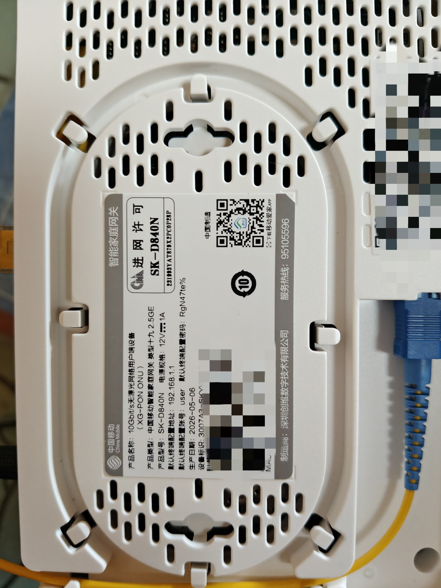
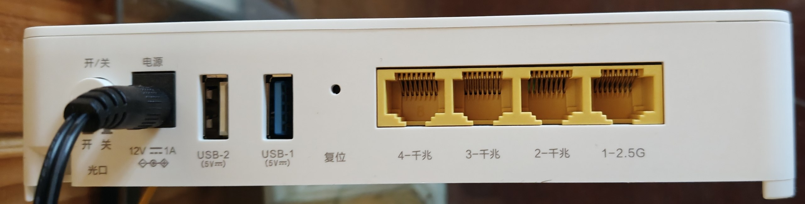
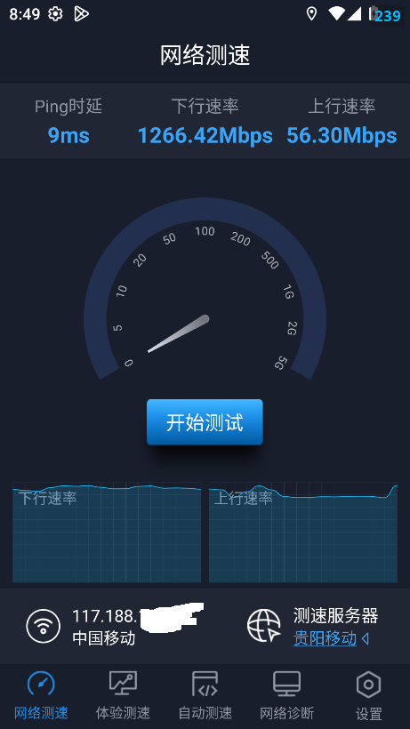
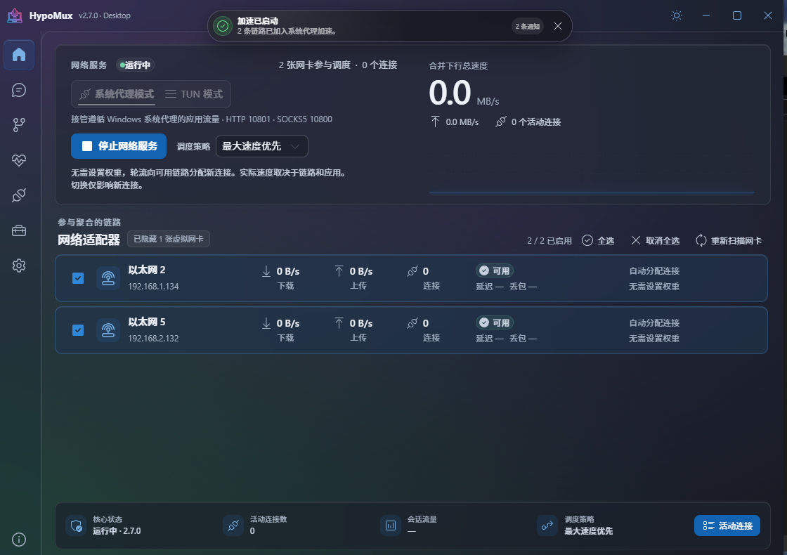
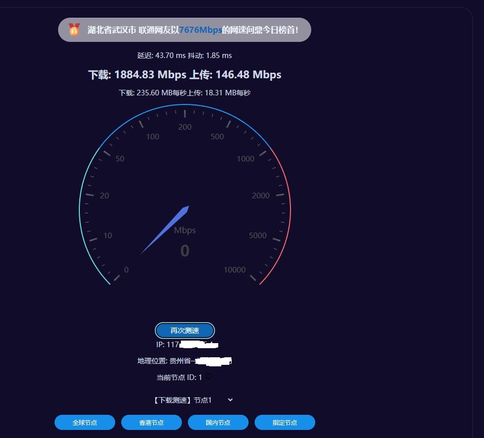
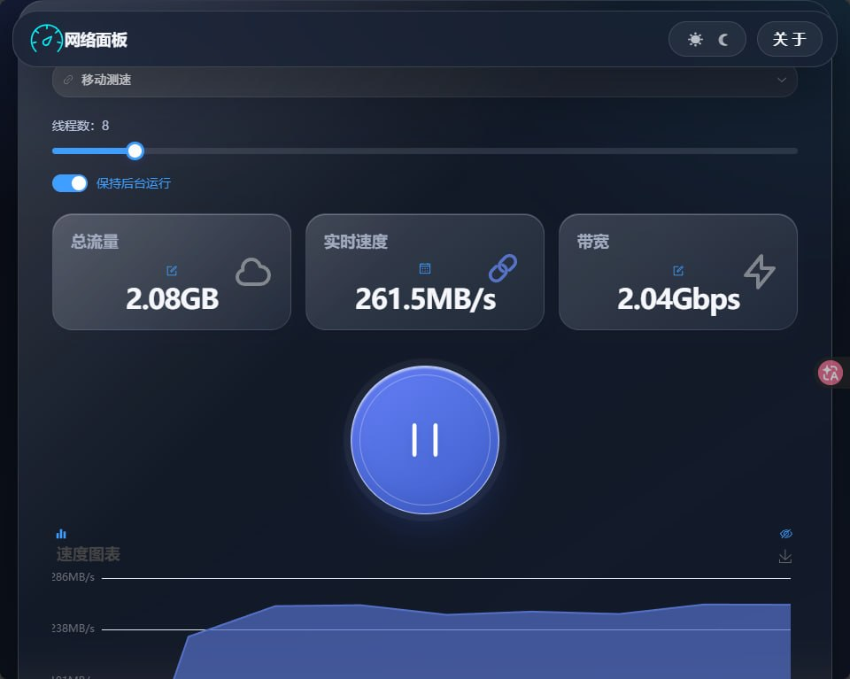
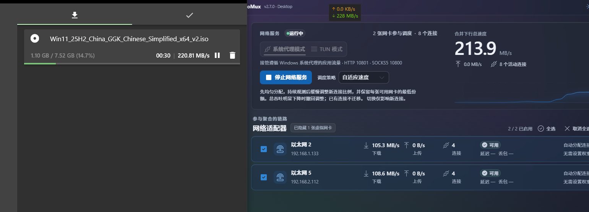
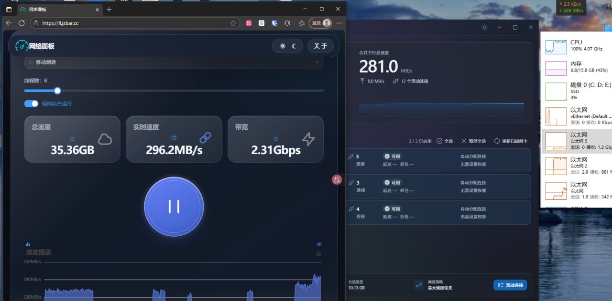

# 前言

2023年时，在网上刷到光猫改桥接的视频，当时啥也不懂，就想自己试试，结果好奇心害死猫。把光猫给重置了，当时没有把注册码给记录下来，导致光猫成砖了。

只能打电话找移动报修。移动师傅上门看了下情况：“现在移动宽带有优惠，你现在的宽带是主卡上的，如果用副卡重新办条宽带，原价一个月30，但是费用是算在主卡上的，主卡的优惠就把这30优惠掉了。”

听到这消息后，家里二话不说就办了，相当于免费送一条宽带，这便宜谁不占啊！

所以师傅就装上了副卡的宽带，主卡的宽带就一直闲置（两条宽带都是移动千兆）。

最近才刚想起来主卡的宽带是闲置的，所以直接给移动打电话，叫师傅把第二条宽带也装上。

# 进入正片

听师傅说，这是最新款的光猫，而且标配2.5G网口，非常不错。




之前折腾NAS时，给电脑装了2.5G的PCIe网卡，这下就可以体验破千兆的感觉了。

可惜全球网测没有电脑版，只能在模拟器上进行测试。在中国运营商的家宽套餐中，运营商会给宽带套餐预留20%的带宽（怕被用户投诉宽带跑不满），所以理论上千兆宽带可以跑到1300Mbps左右，实际测试下来也是如此。



既然家里现在有两条宽带了，那必玩项目就是宽带聚合啊！

**HypoMux启动**
**项目链接**: [HypoMux](https://github.com/Hypostasis-Cat/HypoMux)

> CN Windows 多网卡聚合与网络加速工具。一键融合有线、Wi-Fi、热点等连接，实现多路径传输与智能流量调度。



- 以太网2是主板自带的千兆网卡
- 以太网5是2.5G的PCIe网卡

注：以下所有测试均在 **HypoMux的系统代理模式下进行**

以太网2最大速度在933Mbps左右，以太网5最大速度在1266Mbps左右，理论上双网卡聚合后的速度应该能破2Gbps。

- 先用 **speedtest.im** 的国内测试点测速


下载速度达到了1800Mbps+，上传速度达到了100Mbps+，非常不错。

- 说到测速，我觉得最准确的当然是 **流量消耗器**，这才是检验宽带达标的唯一标准！（测速节点是移动测速，使用8线程，每张网卡分到4线程）
  

效果非常显著，下载速度已经突破了2Gbps！

- 下载微软官方的Win11安装包（启用8线程下载，每张网卡分到4线程）


微软还是财大气粗，速度在220MB/s+，还是不错的。此时主要的瓶颈在于CPU，CPU占用率已经满了。

- **HypoMux** 最大的玩法还是支持多网卡聚合，所以这次极端点。（933Mbps的移动宽带 + 1266Mbps的移动宽带 + 433Mbps的移动5G）


非常强悍！速度来到了惊人的 **2.3Gbps**，CPU已经跑满了！

# 总结

这次双宽带折腾之旅可以说是大获全胜。不仅让闲置的移动千兆宽带重新发光发热，还依靠新款2.5G光猫成功突破了千兆的物理瓶颈。借助HypoMux这款网络聚合神器，我们将主板千兆网卡、2.5G PCIe网卡以及移动5G网络完美融合，跑出了惊人的2.3Gbps极限测速表现。

当然，在享受220MB/s+高速下载带来的极致快感时，系统也迎来了新的短板——随着网速拉满，CPU的性能已经被彻底榨干。这次的网络升级体验极其爽快，这也意味着，要想完全驾驭这套多网卡聚合的极致方案，下一步或许就该考虑给电脑的核心硬件做一次全面升级了。

```
最后,在测试完成后,我还是把新装的2.5G光猫的电源拔了,因为日常使用根本用不到2Gbbps的网速,也只是测速和下载时看个舒服罢了,我还挺享受整个折腾的过程
生命不息 折腾不止
```

 